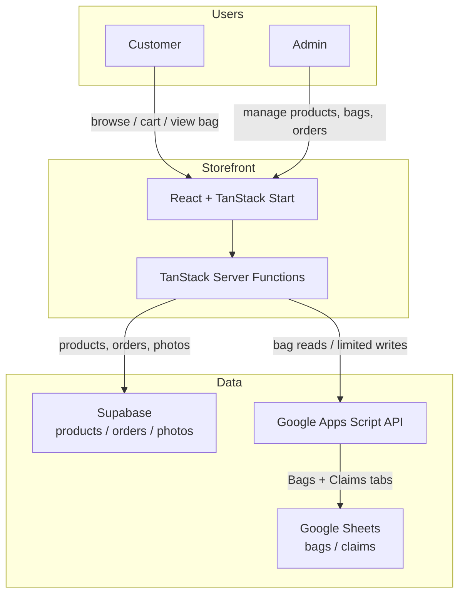

# KimKat Collection

A production commerce and live-sale operations platform built for a TikTok-based jewelry and collectibles business.

Live site: [https://kimkatcollection.com](https://kimkatcollection.com)

## Overview

I built KimKat Collection as a real, customer-facing storefront and back-office tool for a jewelry and collectibles shop that sells primarily through TikTok live sales. The site lets customers browse products, add items to a cart, check out via manual payment links, and look up their live-sale bag by number. A password-protected admin area keeps product, order, and bag management in one place without forcing the business onto a complex SaaS platform it didn't need.

## The Problem

The business was already running on a mix of tools: TikTok for sales, a Google Sheet for tracking live-sale bags and claims, and manual Venmo/Cash App/PayPal payments. A traditional e-commerce platform would have meant migrating the bag workflow, paying for features that wouldn't get used, and retraining day-to-day operations. What was needed was a lightweight storefront that fit the existing process instead of replacing it.

## The Solution

I built a mobile-first storefront that connects to the owner's existing Google Sheets workflow for live-sale bags while handling products, orders, and product photos in a separate Supabase project. Customers get a simple shop and bag lookup; the owner gets an admin dashboard that protects spreadsheet formulas and keeps sensitive data server-side.

## Screenshots

<!-- TODO: add screenshots once assets are available -->

- **Storefront / homepage** — `TODO: storefront-homepage.png`
- **Customer bag view** — `TODO: customer-bag-view.png`
- **Admin dashboard** — `TODO: admin-dashboard.png`

## Architecture



## Key Features

- Mobile-first storefront with a responsive, cozy, on-brand design
- Product listing, detail pages, cart, and manual-payment checkout
- Public "View my bag" lookup by bag number, showing only what a customer needs to see
- Password-protected admin for products, orders, and live-sale bag management
- Google Apps Script integration that reads and writes the owner's existing spreadsheet
- Spreadsheet formula protection: only Payments Received, Due Date, and Status are writable
- Product photos stored in a private Supabase storage bucket
- Server-side credentials and admin session handling

## Product & Technical Decisions

- **Preserve the existing Google Sheets workflow instead of forcing a migration.** The owner's live-sale operation already ran on a spreadsheet. Rebuilding that as a database would have added complexity without improving the business. The Apps Script API bridges the sheet and the site.
- **Separate public and admin access.** Public bag lookup returns only bag number, items, totals, balance due, due date, and status. Customer names, TikTok handles, payments received, and row numbers stay server-side for admin use.
- **Keep sensitive credentials server-side.** All Supabase service-role keys, spreadsheet tokens, and admin secrets live in environment variables and are only used in server functions.
- **Design around existing manual payment methods.** Checkout provides Venmo, Cash App, and PayPal links rather than integrating a payment gateway, matching how the business actually collects money.

## Challenges I Solved

- **Google Sheets integration.** Built a fetch-based Apps Script API that the storefront can call reliably, with caching and privacy-safe responses for public lookups.
- **Protecting spreadsheet formulas.** Limited writes to only Payments Received, Due Date, and Status so the rest of the sheet keeps its formula-driven columns intact.
- **Managing Supabase + Google Sheets together.** Split data cleanly: products, orders, and photos live in Supabase; bags and claims stay in the sheet. This let the site be stateful where it matters without disrupting the existing workflow.
- **Building for real day-to-day business use.** Every feature was shaped by how the owner actually sells: live sales, manual payments, bag numbers, and a simple admin flow.

## Tech Stack

- **Framework:** TanStack Start (React 19, Vite, file-based routing)
- **Styling:** Tailwind CSS v4
- **Backend / data:** Supabase (products, orders, private product-photos bucket)
- **Live-sale data:** Google Apps Script Web App API + Google Sheets
- **Cart:** Browser `localStorage`
- **Admin auth:** Password gate with signed session cookie
- **Package manager / runtime:** Bun

## Project Structure

```text
src/
  routes/            # TanStack file-based routes (storefront, admin, bag lookup)
  lib/               # Server functions, database clients, cart, admin session
  components/        # UI components (cards, header, footer, admin tools)
  assets/            # Brand imagery and backdrop
apps-script/         # BagTrackerAPI.gs — Apps Script to paste into the sheet
```

## Local Development

```sh
bun install
bun run dev
```

Other useful scripts:

```sh
bun run build      # production build
bun run typecheck  # TypeScript check
bun run lint       # ESLint + Prettier
```

## Environment Variables

Set these in Lovable or your deployment platform. Never commit values to the repo.

- `BAG_API_URL`
- `BAG_API_TOKEN`
- `ADMIN_PASSWORD`
- `SESSION_SECRET`
- `SHOP_SUPABASE_URL`
- `SHOP_SUPABASE_ANON_KEY`
- `SHOP_SUPABASE_SERVICE_ROLE_KEY`


## Future Improvements

- Inventory count tracking and low-stock alerts
- Automated payment-status updates from payment apps
- Customer-facing order history
- Admin analytics dashboard for sales and bag trends

## About the Project

KimKat Collection was built as a real production system for a working business, not a demo. The goal was to make the day-to-day selling experience easier while respecting the tools and workflows the owner already had in place.
