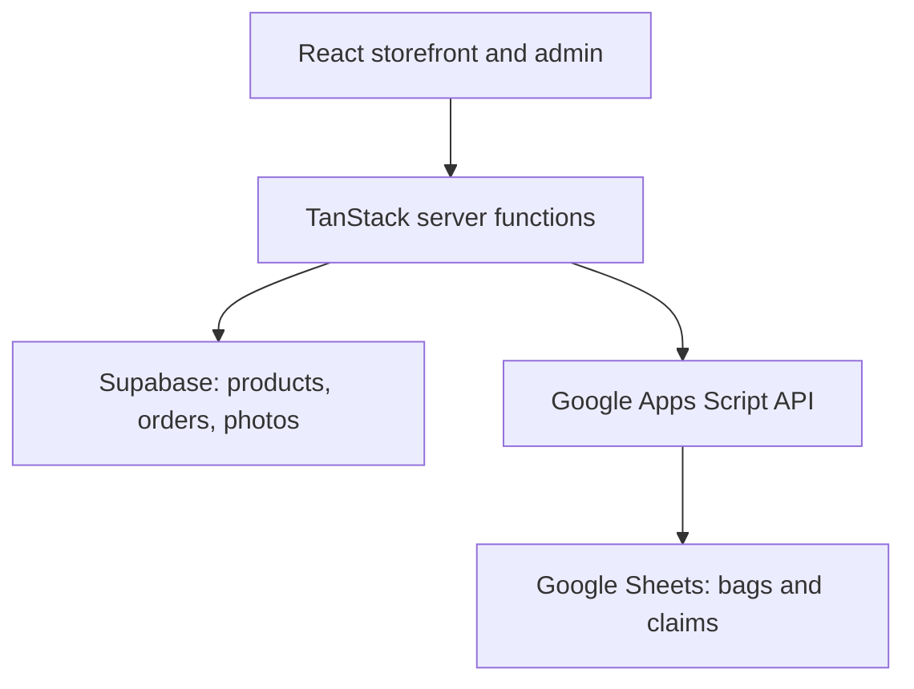

# KimKat Collection

[Visit the website](https://kimkatcollection.com)

## Overview

A mobile storefront and operations tool for a jewelry and collectibles business selling through TikTok Live. Customers claim items into numbered "bags," which the owner manages in Google Sheets. The website lets customers check their bags and balances without waiting for a reply, while preserving the owner's existing workflow.

I used Lovable to scaffold the application and adapted it to the business's storefront and operational requirements, including customer journeys, admin tools, and integrations with Supabase and Google Apps Script.

## Features

- **Customer bag lookup:** View claimed items, totals, balance due, due date, and status.
- **Storefront:** Browse products, view item details, and manage a cart.
- **Checkout:** Submit an order and access Venmo, Cash App, or PayPal payment links. Prices and available quantities are checked against the catalog on the server.
- **Admin workspace:** Manage products, upload photos, and review orders behind a password-protected session.
- **Spreadsheet integration:** The owner manages bags and claims in Google Sheets; the website reads those records for customer bag lookup.

## Adoption and results

**Early adoption: September–October 2026**

- **Adopted in September 2026** as the business's customer-facing tool for checking bags and balances before payment.
- **Supports a customer base of 50+.**
- **200+ item claims recorded** across current and archived tracking records.
- **Approximately half of customers in the latest sales period reviewed were repeat buyers**, based on customer-name matching against earlier claims.

Adoption timing is owner-reported; customer and claim figures come from an October 2026 review of business records. The repeat-buyer figure covers the latest period reviewed.

## Architecture



**Stack:** React 19, TanStack Start, TypeScript, Vite, Tailwind CSS, Supabase, Google Apps Script, and Bun. The cart is stored in the customer's browser.

## Key decisions

- **Fit the existing operation:** Keep bags and claims in Google Sheets; use Supabase for products, orders, and photos.
- **Limit customer-facing data:** Bag lookup excludes customer names, TikTok handles, payment-history fields, and internal row identifiers. Access is by bag number, without customer sign-in.
- **Match the payment process:** Orders await manual payment and availability confirmation. Payment links do not verify transactions, and pending orders do not reserve stock.

## Setup

Install Bun, copy `.env.example` to `.env.local`, and configure your own services.

```sh
bun install --frozen-lockfile
bun run dev
```

Before releasing changes:

```sh
bun run typecheck
bun run lint
bun run test
bun run build
```

The app requires a configured Supabase database and storage bucket, plus a separately deployed Apps Script API connected to the bag-tracking spreadsheet. Credentials stay in server-only environment variables.

See [setup instructions](docs/SETUP.md) for database, storage, spreadsheet, and deployment configuration.

> **Test data:** Historical development notes may reference a test bag under the owner's name. It was used for testing and does not represent a customer transaction.

## Future improvements

- Add customer-specific bag access and individual admin accounts with an audit trail.
- Add inventory reservation and payment reconciliation as the business's ordering workflow evolves.
