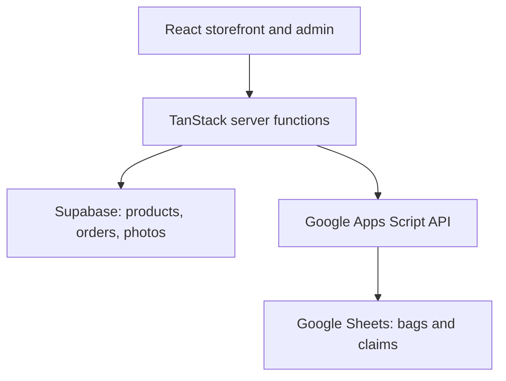

# KimKat Collection

## Case study: connecting a small business's storefront and operations

A customer-facing commerce application that connects a live-sale business's existing Google Sheets workflow with a mobile storefront and an admin workspace.

**Relevant skills:** workflow analysis, stakeholder-focused product decisions, AI-assisted development, API integration, and implementation.

[Business website](https://kimkatcollection.com)

## Business context

KimKat Collection sells jewelry and collectibles through TikTok live sales. Customers claim items during a sale; those items accumulate in a numbered "bag." The owner tracks claims, payments, balances, and status in Google Sheets and accepts payments through existing payment apps.

The product challenge was to give customers a clearer way to browse and check their bags while keeping the owner's familiar spreadsheet workflow.

## My contribution

I used Lovable to scaffold the application and worked on adapting it to the business's storefront and operational requirements. The project brings together customer journeys, an admin interface, server functions, Supabase, and a Google Apps Script API.

This is an AI-assisted implementation project. Its portfolio value is the connection between a real business process and a working application: choosing what to automate, preserving useful existing tools, and understanding the tradeoffs of the resulting system.

## From workflow to product

| Business need                                            | Implemented capability                                             | Transferable lesson                                                 |
| -------------------------------------------------------- | ------------------------------------------------------------------ | ------------------------------------------------------------------- |
| Customers need to review items claimed during live sales | Bag lookup with items, totals, balance, due date, and status       | Translate an internal record into a focused customer experience     |
| Owner already operates from a spreadsheet                | Apps Script API connecting the application to Bags and Claims tabs | Integrate with an established workflow before proposing a migration |
| Customers also need to browse outside live sales         | Product catalog, detail pages, cart, and order submission          | Connect customer-facing features with operational data              |
| Owner needs to maintain records                          | Password-gated product, order, and bag administration              | Design for the person doing the recurring work                      |
| Payments happen through existing apps                    | Manual-payment checkout and pending-confirmation order status      | Match the actual payment process and make its limits explicit       |

## Architecture



The cart uses browser localStorage. Server functions connect to the shop database and spreadsheet API. Admin operations check a session before accessing management functions.

## Decisions and tradeoffs

**Keep the spreadsheet as the live-sale source of truth.** Bags and claims stay in Sheets; products and orders live in Supabase. This fits the existing operation, but introduces two data systems to maintain.

**Limit the public response.** The bag endpoint returns a selected set of fields rather than the full spreadsheet record. Customer names, TikTok handles, payments received, and spreadsheet row identifiers are excluded. Bag-number lookup is still public; it is not customer authentication.

**Constrain bag-summary edits.** Updates to the Bags tab target payments received, due date, and status. Claims have separate add, replace, and delete operations. This distinction matters: the integration does more than update three fields across the entire spreadsheet.

**Reduce repeat spreadsheet requests.** The server uses a 30-second in-memory read cache, invalidates it after writes, and supports single-request bag-and-claims lookup. Older Apps Script deployments have fallback paths. The cache is local to a server instance; it is not shared infrastructure.

**Keep payment confirmation manual.** Submitting an order records it as pending payment confirmation. Payment links support the existing process; they do not verify payment or provide automated reconciliation.

## What the project demonstrates

- Turning a business workflow into customer and admin requirements.
- Connecting familiar tools through APIs rather than replacing the whole process.
- Making practical scope decisions around payments, data ownership, and administration.
- Using AI development tools to implement a real application while inspecting how the pieces work.
- Explaining implementation constraints clearly to technical and nontechnical audiences.

## Results and next validation

The repository implements the storefront, cart, order submission, bag lookup, admin tools, and spreadsheet integration described above. This case study does not claim measured time savings, revenue impact, adoption, or conversion improvements.

Useful next measures are repeated customer balance questions, owner time spent updating bags, lookup success rate, and checkout completion. Establish a baseline before attributing an improvement to the application.

## Known limitations and next steps

- Checkout reloads catalog prices and stock on the server, rejects changed prices and unavailable quantities, and calculates totals in integer cents. Pending orders do not reserve or decrement inventory; the owner confirms availability and payment manually.
- Public bag lookup needs an explicit decision about acceptable disclosure and stronger access controls if required.
- Claim edits use delete-then-add operations; stable item identifiers and atomic updates would improve reliability.
- Shared-password administration is a simple starting point; individual accounts and audit history would support broader use.
- Deployment configuration, database policies, storage access, and live payment behavior require environment-specific verification.

## Technical reference

**Stack:** React 19, TanStack Start, Vite, TypeScript, Tailwind CSS v4, Supabase, Google Apps Script, Google Sheets, Bun.

### Source map

| Path                              | Responsibility                                                   |
| --------------------------------- | ---------------------------------------------------------------- |
| `src/routes/`                     | Storefront, product, cart, checkout, bag lookup, and admin pages |
| `src/lib/bags.functions.ts`       | Public bag response and authenticated bag administration         |
| `src/lib/sheets.server.ts`        | Spreadsheet transport, cache, mappings, and writes               |
| `src/lib/shop.functions.ts`       | Product queries and order submission                             |
| `src/lib/shop-db.server.ts`       | Public and privileged Supabase clients                           |
| `src/lib/admin-session.server.ts` | Admin password verification and session handling                 |
| `apps-script/BagTrackerAPI.gs`    | Spreadsheet API deployed separately in Google Apps Script        |

### Local development

```sh
bun install
bun run dev
bun run typecheck
bun run test
bun run build
```

The repository also provides `bun run lint` and `bun run format`.

Copy `.env.example` to `.env.local` and configure your own services; never commit their values. See [setup](docs/SETUP.md) and [verification status](docs/VERIFICATION.md).

Required server-only variables:

- `BAG_API_URL`
- `BAG_API_TOKEN`
- `ADMIN_PASSWORD`
- `SESSION_SECRET`
- `SHOP_SUPABASE_URL`
- `SHOP_SUPABASE_ANON_KEY`
- `SHOP_SUPABASE_SERVICE_ROLE_KEY`

The Apps Script project expects `SECRET_TOKEN` in Script Properties and `Bags` and `Claims` sheets with the column layout defined in the script. Local source alone does not provision the database, storage bucket, or spreadsheet service.

## Portfolio framing

**One-line description:** Built an AI-assisted storefront and operations tool that connects a live-sale business's Google Sheets workflow with customer bag lookup and an admin interface.

**Interview discussion:** How to understand an existing process, choose a useful scope, connect tools, and explain what still needs validation before scaling.
